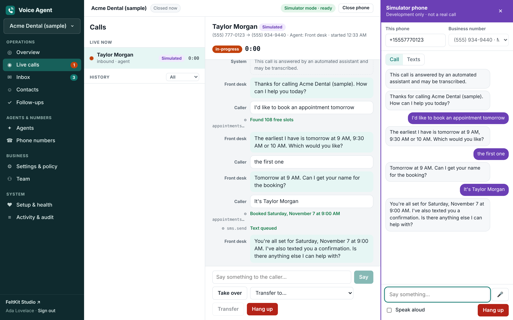
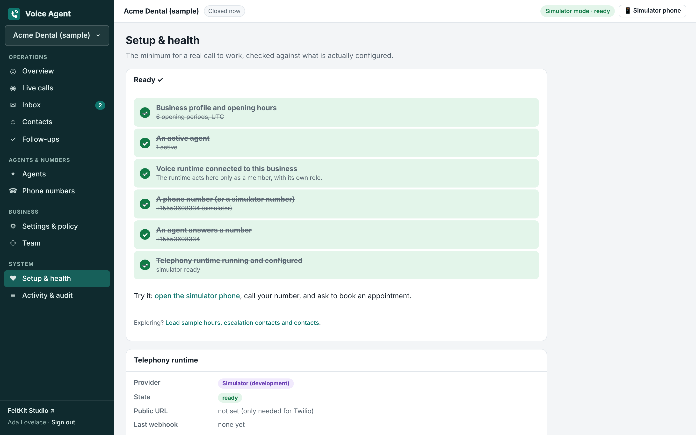

# Voice Agent

**An open-source starter for a phone and SMS agent that does real work for a business — built on [FeltKit](https://getfeltkit.com).**

Callers phone or text a business. An agent answers, books an appointment from real free slots, texts a
confirmation, takes a message, or hands the caller to a person. Staff watch calls live, step in, reply by
text, and see everything that happened. It is multi-business: each business has its own numbers, agents,
hours, policy, contacts and history, and none can see another's.

> **Code defines what the application can do. Configuration determines how it operates.**
> Agents, numbers, hours, routing, voice, model, provider and credentials all change without editing TypeScript.
> New capabilities are code.



## Quick start (no phone number, no credentials)

Requires Node 22.

```bash
npm install
```

```bash
npm run dev
```

`npm run dev` prints:

```
  App        http://localhost:3000
  Dashboard  http://localhost:3000/_feltkit/#token=fka_…
  AppPort    http://localhost:3000/appport  (… capabilities)
  MCP        http://localhost:3000/mcp
```

1. Open <http://localhost:3000/?as=ada> (Ada is a development identity; she also holds the deployment `operator` role).
2. Choose **Open sample business**. It creates *Acme Dental (sample)* with hours, a **Front desk** agent, a
   **simulated** phone number and two contacts, connects the voice runtime, and opens **Setup & health**.
3. Click **📱 Simulator phone** (top right) and **Call**. Say (type, or use the 🎤) *"I'd like to book an
   appointment tomorrow"*, then *"the first one"*, then your name.
4. Watch it on **Live calls**: the transcript, each capability the agent invoked and its result, and controls
   to speak, take over, transfer or hang up. When you hang up, the call is summarised and the confirmation
   text appears in the **Inbox** with its delivery status.

Everything the simulator produces is labelled **Simulated**. It is a provider adapter like Twilio's and goes
through the same code paths; it is not a real phone network.

## Code and Control

| Code (`feltkit/`, `gateway/`, `src/`) | Control (this app and FeltKit Studio) |
|---|---|
| Collections, roles, the authorization policy | Agents: instructions, greeting, voice, model, temperature, granted capabilities, escalation, schedule |
| Agent capabilities (`feltkit/tools.ts`) | Phone numbers: agent, fallback routing, SMS/voice, caller ID |
| The provider adapter boundary (`gateway/providers/`) | Business: hours, time zone, description, escalation contacts, communication policy |
| The voice loop and agent brains (`gateway/`) | Provider, account, public URL (Studio → Configuration); auth token (Studio → Credentials) |
| UI (`src/`) | Model provider, model, API key (Studio → Models) |
| | Events to a CRM or calendar sync (Studio → Webhooks); other APIs as capabilities (Studio → Integrations) |

Business configuration is done by the business's owners and admins in the app (it is per-business data in
FeltDB, also browsable in Studio → Data). Deployment configuration is operator work in **FeltKit Studio**.
The app's **Setup & health** page shows what is missing and where each setting lives.



### Studio (development)

Open the **Dashboard** link `npm run dev` printed (the token in it is the sign-in). On Services pages, choose
**Act as → Ada Lovelace (operator)**.

| Studio page | For this app |
|---|---|
| Services → Configuration | `TELEPHONY_PROVIDER` (`simulator` or `twilio`), `TWILIO_ACCOUNT_SID`, `PUBLIC_BASE_URL` |
| Services → Credentials | `twilio-auth-token` |
| Models | The model agents set to *"the model selected in Studio"* converse with (Anthropic, OpenAI, Ollama, any OpenAI-compatible endpoint) |
| Services → Webhooks | Endpoints for `call.completed`, `message.received`, `appointment.booked`, `followup.created`, `contact.opted_out` (signed, retried, recorded) |
| Data | Every collection (`agents`, `phoneNumbers`, `calls`, `transcripts`, `invocations`, `audit`…) |
| Capabilities | The agent capabilities and configuration functions, runnable as any identity |
| Activity | Every function call with identity, transport and outcome, including refusals |

The voice runtime re-reads Configuration, Credentials and Models every few seconds: no restart.

## Connect Twilio (real calls and texts)

You need a Twilio account, a voice- and SMS-capable number, and a public **https** URL that reaches the app
(port 3000). In development use a tunnel, e.g. `cloudflared tunnel --url http://localhost:3000` or
`ngrok http 3000`. Through a tunnel only the voice component's routes (`/twilio/*`) answer; FeltKit's own
routes and Studio stay local-only in development, and the simulator answers only on this machine.

1. **Studio → Services → Configuration** (act as Ada): add `TELEPHONY_PROVIDER` = `twilio`,
   `TWILIO_ACCOUNT_SID` = your `AC…` id, `PUBLIC_BASE_URL` = your tunnel's https URL.
2. **The auth token**, from Studio → Services → Credentials, or:
   ```bash
   npx feltkit credential set credential-ref:twilio-auth-token
   ```
3. **In the Twilio console**, on the number: *A message comes in* → `<PUBLIC_BASE_URL>/twilio/sms`,
   *A call comes in* → `<PUBLIC_BASE_URL>/twilio/voice`, *Call status changes* → `<PUBLIC_BASE_URL>/twilio/call-status`
   (all HTTP POST).
4. **In the app → Phone numbers**: attach the number with provider **Twilio** and choose its agent.

Setup & health turns green when the runtime is configured. Every Twilio request is signature-checked
(`X-Twilio-Signature`); unsigned and forged requests are refused and counted there. Calls use Twilio
**ConversationRelay**: Twilio does speech recognition, speech synthesis and barge-in detection; the runtime
receives text and streams the agent's answer back. The voice is chosen per agent (provider and voice id).

STOP/HELP replies to texts are sent by Twilio's own opt-out handling; the app records the opt-out and never
texts that contact again until START.

## Use a model

Agents default to the **scripted** brain: deterministic, no model, no key, and it does real work (books,
texts, takes messages, transfers). To converse with a model, select one and set the agent's *Brain* to
*"The model selected in Studio → Models"*:

```bash
npx feltkit model set --provider anthropic --model claude-sonnet-5-5 --api-key-stdin
```

Or Studio → Models. The model only ever sees the capabilities its agent is granted, and every request it
makes goes through the authorization policy (a refusal is recorded and returned to it).

## How it is built

```
 Caller ── PSTN ── Twilio ──(signed webhooks + ConversationRelay WebSocket: /twilio/*)──┐
 Browser ───────────────────────(app, Studio, AppPort: everything else)────────────────┤
                                                                                         ▼  one port
 ┌──────────────────── one process: `feltkit dev` / `feltkit start` ─────────────────────┐
 │  FeltKit: functions (feltkit/*.ts), policy, Studio, AppPort, MCP, Services, FeltDB      │
 │   └─ runtime component "voice" (gateway/component.ts), declared in feltkit/app.ts:      │
 │        providers/twilio.ts · providers/simulator.ts · voice.ts · brain/ · runtime.ts    │
 │        acts only through the app's functions as "voice-runtime", in a business by live  │
 │        membership; reads only the twilio-auth-token credential; reports health          │
 └─────────────────────────────────────────────────────────────────────────────────────────┘
```

- **One application, one process, one port.** The voice runtime is a FeltKit *runtime component*
  (`feltkit({ components: { voice } })`): `feltkit build` bundles it, `feltkit dev`/`feltkit start` run it with
  the app, every `feltkit deploy` target carries it, and `/_feltkit/health` is `ready` only when voice is
  (`partial` when the app serves but voice is not configured, `unhealthy` when voice failed; named checks
  `webhooks`, `media`, `work`).
- **FeltDB is the only source of truth.** The voice runtime holds no state: every event is a call to the
  app's functions as its own principal (`voice-runtime`, role `voice`), inside the business it belongs to,
  checked against its *live* membership. A business that removes it closes it out on the next call.
- **Businesses are FeltKit tenants.** Every business record is tenant-scoped; `authorize` (default deny)
  never trusts a business id from a request.
- **Agents act only through capabilities** (`feltkit/tools.ts`, published on AppPort), each with an explicit
  identity, an authorization decision, validated arguments, a defined result, and an audit record keyed by
  tool-call id (repeating it cannot act twice). An agent profile's capability list is enforced by the policy,
  not by the prompt.
- **Provider receipts establish reality.** A text is "sent" only with the provider's id; an interrupted send
  becomes `unknown`, never resent. Statuses only move forward. Each provider event is recorded once.

Details: [docs/ARCHITECTURE.md](docs/ARCHITECTURE.md) (assessment, decisions), [docs/GAPS.md](docs/GAPS.md)
(platform gaps), [docs/ACCEPTANCE.md](docs/ACCEPTANCE.md) (what is tested and what is not, production readiness).

## Tests

```bash
npm test
```

37 tests against FeltKit's test runtime (a real, isolated FeltDB), with the voice runtime on a real port,
a simulated phone speaking ConversationRelay over a real WebSocket, a local stand-in for Twilio's REST API
with signed webhooks, and a fake streaming model: functional, security, reliability, Twilio adapter, model
and policy tests.

```bash
npm run test:e2e
```

The browser test, against a running `npm run dev` started on fresh state (`rm -rf .feltkit/development`
first). It drives the UI as an operator, calls from the simulator phone, and writes `docs/screenshots/`. Set
`DASHBOARD_URL` to the printed Dashboard link to include Studio.

```bash
npm run typecheck
```

## Build and deploy

```bash
npx feltkit deploy --target container
```

The supported FeltKit command builds the functions, the frontend **and the voice component**, boots the
result, and refuses to write an artifact unless the voice component loaded and its routes reach it. The
artifact (`.feltkit/deploy`) runs anywhere its `DEPLOY.md` says: Docker (`docker compose -f
.feltkit/deploy/docker-compose.yml up --build`) or plain Node (`npm ci --omit=dev && npm start` in it). One
process serves the app, Studio, AppPort and the voice routes on `PORT`; the container's health check is
`/_feltkit/health`, so a deployment whose voice component is down is reported unhealthy. The other
targets (`--target fly`, `hosted`, `self-hosted`, `vercel`, `cloudflare`) carry the component the same way.

In production:
1. Set `FELTKIT_AUTH_SECRET` (and the rest of `.env.example`) on the host.
2. Put the Twilio auth token in `FELTKIT_CREDENTIAL_TWILIO_AUTH_TOKEN` (FeltKit's production custody reads it there).
3. Set `TELEPHONY_PROVIDER`, `TWILIO_ACCOUNT_SID`, `PUBLIC_BASE_URL` with `npx feltkit config import <file> --env production`.
4. Route the public https name to the app's port unchanged (a reverse proxy must pass WebSocket upgrades);
   point Twilio at `<PUBLIC_BASE_URL>/twilio/...`.

Until 2–3 are done the app serves people but `/_feltkit/health` answers 503 `partial` with the reason.
Rollback: start the previous artifact on the same state (the container target's contract). Evidence of all of
this, on the real artifact: [docs/DEPLOYMENT-EVIDENCE.md](docs/DEPLOYMENT-EVIDENCE.md) (`node --import tsx scripts/deployment-evidence.mjs`).

`npx feltkit deploy --target appboundry` does not run this application: AppBoundry hosts have no accounts or
tenancy yet and refuse application agents (docs/GAPS.md).

Production Studio is off unless `FELTKIT_DASHBOARD=1` and `FELTKIT_OPERATOR_KEY` are set; then
`npx feltkit manage` prints a one-time sign-in link. `npx feltkit readiness --env production` checks the
environment before you go live.

**This branch uses an unreleased FeltKit** (runtime components, rkendel1/feltkit branch
`claude/eager-ritchie-qazq3g`), vendored as `vendor/feltdb-feltkit-0.3.19-components.1.tgz` so a clean clone
installs and deploys. Replace it with the published release once there is one.

## Troubleshooting

| Symptom | Cause |
|---|---|
| Setup says "The runtime has not reported" | The app is not running, or its voice component failed to start: `/_feltkit/health` names the reason. |
| Twilio webhooks get 503 | Twilio is not fully configured: Setup & health lists what is missing. |
| Twilio webhooks get 403; *Rejected requests* grows | `PUBLIC_BASE_URL` differs from the URL Twilio calls (scheme, host, trailing slash), or the auth token is wrong. |
| An agent answers with the scripted brain although set to the model | No model is ready: Setup & health says why; fix it in Studio → Models. |
| A text shows `blocked` | Policy: the contact opted out, quiet hours, or no SMS number. The reason is on the message. |
| A text shows `unknown` | The runtime stopped while handing it to the provider. Check the provider's log before resending. |
| Outbound call refused | Policy: outbound calls off, no recorded consent, do-not-call, quiet hours or hourly limit. |
| The simulator phone answers 403 | The simulator serves only on localhost, outside production. |

## License

MIT
